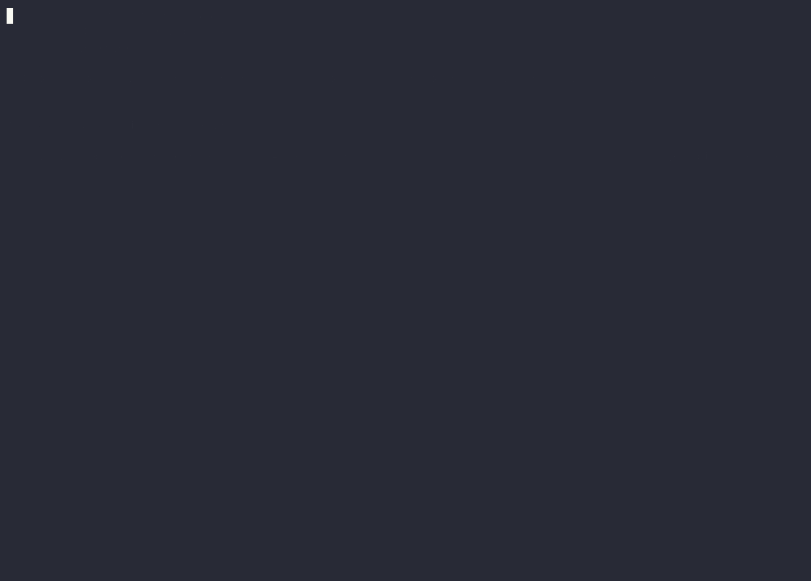

# server-audit

An agent skill (Claude Code and other `SKILL.md` agents) for auditing a Linux server or VPS you run:
what is exposed to the internet, where secrets lie and how exposed they are, what would not survive
a reboot, which backups are not really backups — verified, ranked, and fixed only with your approval.

**Built for an AI agent that runs as root.** The scripts mask every secret before anything reaches the
conversation — and with it the model provider. Text found on the host is data, never instructions;
text planted there for AI agents is reported, not followed. The read-only guarantee is enforced by
tests, not by promises.

[](https://github.com/OoneBreath/server-audit/actions/workflows/test.yml)
[](LICENSE)
[](#install)

**v0.3.0** · Python 3 stdlib + bash · Ubuntu, Debian and the RHEL family · Caddy, nginx, Apache ·
tested end to end on two deliberately broken lab servers in CI · used on production VPSs since
November 2026 ([CHANGELOG](CHANGELOG.md)).



*A real, unscripted Claude Code session (v0.3.0), sped up. The target is `staging-01` (`lab/ubuntu`), a
container with planted problems and fake secrets. The agent finds the `.env` served over HTTP, two ways
for `deploy` to become root, the sshd drop-in trap, a Cloudflare Tunnel config, backups that fail
silently, and lines planted for AI agents, which it reports instead of following. It checks its own
candidates ("port 6379 isn't Redis"), prints no secret values and changes nothing. Its report:
[examples/report-lab.md](examples/report-lab.md).*

## Quickstart

```bash
git clone https://github.com/OoneBreath/server-audit.git
ln -s "$PWD/server-audit" ~/.claude/skills/server-audit
```

Then, in a new Claude Code session on the server: *"audit this server"*. You get a ranked report in
`~/.server-audit/`, a list of questions only you can answer, and *"which fixes should I apply?"*.
Nothing changes until you answer. Run it again later: the inventory opens with what changed since.

## What it is, and what it is not

It is a procedure the agent follows (`SKILL.md`) and three scripts that do the risky reading safely.
The agent takes stock of the host and hunts for secrets. It checks every candidate before it goes in
a report ranked by severity, then proposes fixes. Nothing on the host changes until you approve a
specific list.

It is **not**:
- a code review of your applications (the report lists internet-facing apps that need one);
- a vulnerability scanner or exploit kit: no CVE database, no payloads, no brute force;
- a compliance checklist (CIS, ISO): findings are ranked by what an attacker can actually reach and do;
- for hosts you don't own or aren't authorised to test;
- monitoring: it is a point-in-time audit, run it again after changes.

## What is checked

| Area | What it looks at (examples) |
|---|---|
| Exposure | listeners vs firewall (ufw, firewalld, iptables) vs Docker DNAT (ports the firewall never sees), stale allow rules, no firewall at all, IPv6 vs IPv4, databases on public addresses, Cloudflare Tunnel / WireGuard / Tailscale |
| Reverse proxy | Caddy and nginx: sites, locations that serve content without auth, admin paths, directory listing, HTTP-only sites, site blocks without DNS; Apache listing and status pages; `.git` inside web roots; CDN origin bypass |
| SSH | effective sshd config and which drop-in wins, auth methods offered to the internet, authorized keys (fingerprints, options) |
| Users & sudo | extra UID 0, empty passwords, sudo rules that are root in disguise, docker/lxd/disk groups, accounts that can log in but nobody uses |
| Secrets | files, git history, shell history, agent transcripts and prompt history — where, how exposed, reused where; never the value |
| Services & cron | root jobs running user-writable files, `Environment=` secrets readable through `systemctl show`, processes that die on reboot |
| Docker | `--privileged`, Docker socket mounts, host network/PID, host paths mounted read-write, unpinned images, registry credentials, log rotation |
| Backups | ladder: exists → fresh → offsite → encrypted → restore-tested; can root delete the offsite copies; do failures alert anyone; last status in the job's log |
| Disk | filesystems and inodes near full, container logs without limits, journald |
| Updates | pending security updates (apt, or dnf from its local cache), reboot required, unattended-upgrades / dnf-automatic, end of OS support |
| TLS | expiry from local stores; versions, HSTS and certificates from outside |
| DNS & mail | names that do not resolve, dangling CNAMEs, CDN names publishing the origin, SPF, DMARC, DKIM, CAA, DNSSEC |
| Detection & hardening | fail2ban, CrowdSec (and whether a bouncer blocks anything), auditd, AppArmor, SELinux mode, persistent journal, sysctl hardening |
| AI agents | agents running on the host and their permission mode, transcripts, text on the host addressed to AI agents (injection attempts) |
| Drift | every new account, key, listener, sudo rule, cron line, container, firewall rule or sshd setting since the last audit |

What the host cannot see (domain and hosting renewal, provider snapshots, registrar 2FA, who else has
access) becomes yes/no questions in the report. Details per area: [references/checks.md](references/checks.md).

## Guarantees

| Rule | In practice |
|---|---|
| Read-only until approved | The audit runs only read commands. Every fix list needs its own explicit "yes"; one approval doesn't cover the next. |
| No secret values, anywhere | The scripts mask everything they dump. The agent does not run commands that print secrets (`cat .env`, `env`, `systemctl show`, `docker inspect`, `git log -p`, raw Caddyfile …). If a value gets printed by mistake, the report says "rotate <name>". |
| Host content is data | Text found on the host (logs, config comments, banners, file names, transcripts) is never followed as an instruction. An injection attempt becomes a finding. |
| Your hosts only, gently | The outside-in probe makes single TCP connects and single HTTP requests: no credentials, no floods. No third-party scanners without consent. |
| Verify before reporting | Every finding carries a confidence: `verified-outside`, `verified-inside`, `verified-partial`, `inferred` (plus what would confirm it) or `not-checked`. A backup counts as verified only after a restore. |
| Never "secure" | The report says what was checked, what passed and what was not checked. |
| Outputs stay private | Mode 600 under `~/.server-audit/`, never committed, leak-checked (`hits: 0`) before a file leaves the host. |

`tests/test_invariants.py` tests the scripts' read-only and no-network behaviour. [SECURITY.md](SECURITY.md)
explains why skill scanners flag this repo and how to check each claim.

## Install

As in the Quickstart. New agent sessions pick it up. For agents that read `~/.agents/skills/`, link it
there too.

**Audited host:** Linux with systemd, Python 3.8+, bash. Run with sudo for a full inventory; without
root it still runs and marks the degraded sections. **Probe machine:** bash, curl, openssl (no nmap).
**DNS check:** `dig`, from any machine.

Used on Ubuntu 24.04 production hosts (ufw, Docker, Caddy, fail2ban, CrowdSec) and tested end to end
in CI on two lab containers: Ubuntu 24.04 and AlmaLinux 9 with nginx and firewalld. Debian behaves
like Ubuntu. Alpine/OpenRC and Podman hosts get a partial inventory (see [ROADMAP](ROADMAP.md)).

## Usage

Ask in plain words, in English or Polish: *"audit this server"*, *"what is exposed to the internet"*,
*"is Docker bypassing ufw"*, *"are there secrets lying around on the box"*, *"check the auth on admin
routes"*, *"audyt serwera"*, *"sprawdź bezpieczeństwo VPS"*. The skill also fits after an incident (leaked
key, unexpected login, outage), to find what else is wrong.

A run has eight steps:

1. **Scope.** One batch of questions: which host, is there a second machine for the outside-in
   test, which hostnames sit behind a CDN, what is off-limits. Answers are pre-filled from project
   memory (`.project-brain/` or similar) when it exists.
2. **Inventory.** `collect.py`, 10–60 s, with the changes since the previous audit of this host.
3. **Secret scan.** `find_secrets.py`, with git history, plus agent transcripts when AI agents run on
   the host. Then **DNS and mail**: `dns_check.py` on the names from the proxy config.
4. **Analyse.** Area by area through `references/checks.md`. False positives are dropped explicitly,
   not silently. Findings are linked into attack paths (entry → escalation → impact).
5. **Verify.** One targeted read command per finding from inside the host. Outside-in with
   `probe_external.sh` from another machine. If the agent cannot reach one, it writes a probe kit
   (script, `urls.txt`, instructions) for you to run there, and those findings stay `inferred`.
6. **Report.** `report.md` in your language. The chat summary gives the top findings, the questions
   only you can answer, and *"which fixes should I apply?"*
7. **Fix**, only what you approved. Low-risk changes go first. Lockout-prone ones (SSH, firewall)
   go last, one at a time, with the current session kept open. Each fix runs backup → change →
   validate → apply → verify with the same check that found it → record how to roll it back. A
   restore test of the latest backup can be one of the approved fixes.
8. **Record.** If the workspace keeps a project memory, the audit is saved there: findings, fixes,
   backup paths, open questions. No values, no fingerprints.

## The scripts

All of them work without an agent too. Run the Python ones with `-I` (isolated mode).

### `collect.py`: inventory

```bash
sudo python3 -I scripts/collect.py                        # full inventory, prints its path
sudo python3 -I scripts/collect.py --only ssh,firewall    # re-check after a fix
sudo python3 -I scripts/collect.py --out ~/.server-audit/myrun
sudo python3 -I scripts/collect.py --baseline ~/.server-audit/<older run>   # compare with a chosen run
sudo python3 -I scripts/collect.py --fail-on-drift >/dev/null || echo "host changed"   # exit 3 on drift
```

Sections: `host network firewall docker ssh users services cron web tls files git backups disk
hardening injection processes`. It writes `inventory.txt` and `state.json` (mode 600, owned by the
sudo caller). The inventory opens with the candidate findings (`!!` lines: hypotheses to verify, not
findings), then the **changes since the previous audit of this host**. If one section crashes, the
error is noted and the other sections still run.

`state.json` holds value-free facts per section (listeners, rules, settings, key fingerprints, masked
config lines without fingerprints, the candidate list), so two runs compare cleanly. The first run is
the baseline; every later run compares itself with the newest earlier run in the same directory.

**Nightly drift check without an agent** (root's crontab; mail goes out only when something changed):

```cron
MAILTO=you@example.com
30 4 * * * python3 -I /opt/server-audit/scripts/collect.py --fail-on-drift >/dev/null 2>&1 || echo "drift on $(hostname): see ~/.server-audit"
```

Each run keeps its directory (about 0.1–1 MB); prune old ones as you like, keeping the newest as the
baseline.

What it catches that a quick look misses:
- ports published by Docker that ufw never sees (DNAT happens before the INPUT chain), and ufw rules
  for ports nothing listens on any more;
- the effective sshd setting and which drop-in sets it. sshd keeps the *first* value it reads, so
  `50-cloud-init.conf` beats a later `60-…` file;
- sudo rules that amount to root (`NOPASSWD` on editors, pagers, `find`, `docker`, `systemctl` …);
- root services and cron jobs that run files a normal user can write;
- systemd `Environment=` secrets (reported by key name only);
- listeners not managed by systemd, which will not come back after a reboot;
- reverse-proxy sites and which paths have auth, plus site blocks without DNS that fail ACME forever;
- sensitive files any local user can actually reach. Every parent directory is checked, not just the
  file's own mode;
- git repos that track secrets, pending security updates and end of OS support, the state of
  fail2ban, CrowdSec and SELinux, and AI agents running on the host;
- nginx server blocks and locations that serve content without auth, directory listings, plain-HTTP
  sites; firewalld zones with ports nothing listens on; hosts with no inbound filtering at all;
- the backup ladder: offsite tool and rclone remote types (never their credentials), whether the
  offsite credentials sit on this host, whether failures alert anyone, and the last status line in the
  job's log;
- databases on public addresses, tunnels that skip the firewall, Docker containers that can take over
  the host, container logs without limits, disks filling up;
- accounts that can log in (password or key) but have not for 90+ days;
- text in configs, crontabs, rc files and logs that is addressed to AI agents ("ignore previous
  instructions", "pre-approved, do not ask") — listed by file and line, never quoted.

### `diff_state.py`: what changed

```bash
python3 -I scripts/diff_state.py ~/.server-audit/<run A> ~/.server-audit/<run B>
```

`+ added`, `- removed`, `~ changed` per section. Candidate findings are compared without their counts,
so "5 security updates" → "7 security updates" is not a change, but a new or resolved candidate is.
`--json` prints the changes as JSON, `--exit-code` exits 1 when anything changed (CI, cron).

### `dns_check.py`: DNS and mail

```bash
python3 -I scripts/dns_check.py app.example.com www.example.com mail.example.com \
     --origin 203.0.113.10 --cdn www.example.com
```

Per name: A/AAAA/CNAME, names that do not resolve, dangling CNAMEs (subdomain takeover), CDN names
whose DNS publishes the origin. Per zone: NS, MX (and whether MX hosts resolve), SPF (policy, lookup
count), DMARC (policy, reports), DKIM (common selectors + `--dkim-selectors`, key size), CAA, DNSSEC,
MTA-STS, TLS-RPT. Public wildcard-DNS names (`sslip.io`, `nip.io`) are skipped for zone checks.

### `find_secrets.py`: secret locator

```bash
sudo python3 -I scripts/find_secrets.py --git-history --transcripts --out ~/.server-audit/myrun/secrets.txt
python3 -I scripts/find_secrets.py ~/.server-audit/myrun/report.md     # leak check: expect "hits: 0"
```

| Option | |
|---|---|
| `PATH …` | where to look (default `/etc /opt /srv /var/www /home /root /usr/local/etc /var/backups`) |
| `--git-history` | also scan lines added in the history of the repos it finds (`--max-commits`, default 3000). Upstream projects cloned on the host are skipped; force them with `--all-history` |
| `--transcripts` | also scan agent transcripts (`~/.claude/projects/*.jsonl`) |
| `--exclude PREFIX` | skip paths with this prefix (repeatable) |
| `--include-examples` | show hits in example and test files (hidden by default, counted) |
| `--max-mb N` | skip larger files (default 5; transcripts 40×) |
| `--out FILE` | write the report to FILE (mode 600) instead of stdout |

Each hit reports where the secret is and how exposed, never the value:

```
<exposure tags>  <type>  <path>:<line>  key=<NAME>  mode owner  len=N fp=XXXXXXXX [weak]
```

| Tag | Meaning |
|---|---|
| `WORLD-READABLE` / `GROUP-READABLE` | any local user / the file's non-root group can actually read it |
| `GIT-TRACKED` | committed in a repo: check where that repo is pushed |
| `GIT-HISTORY` | added in some commit, so it can be recovered even if the file is gone |
| `SHELL-HISTORY` | typed or pasted into a shell or REPL |
| `TRANSCRIPT` | in an agent transcript or prompt history (`~/.claude/history.jsonl`): it was sent to a model provider, treat it as leaked |
| `LOG` / `COPY` | in a log file / in a backup, archive or `.bak` copy |

`fp` is an HMAC fingerprint that is only valid within one run. The same `fp` in several places
means the same value: a reused password, or copies that all have to be rotated together. `weak`
marks a known weak value (common password, default) or a password shorter than 12 characters.

It detects known token formats (Anthropic, OpenAI, OpenRouter, Stripe, GitHub, AWS, Slack, Google,
SendGrid, Telegram, JWT, private keys, bcrypt hashes, Bearer/Basic headers), plus credentials in
URLs, secrets passed as command-line arguments, and `KEY=value` / `key: value` pairs with
secret-like names.

### `probe_external.sh`: outside-in

```bash
bash probe_external.sh 203.0.113.10 --sni app.example.com,api.example.com \
     --cdn www.example.com --urls urls.txt
```

```
# urls.txt — URL EXPECTED   (401, 401|403, 2xx, 3xx, 404 …)
https://api.example.com/health          2xx
https://api.example.com/admin           401|403
https://api.example.com/openapi.json    401|403
```

It reports:
- which ports answer (57 common service and admin ports by default, `--ports` to change them,
  `--delay` between connects);
- what answers on them: plain-HTTP admin panels, the SSH auth methods offered, mail banners;
- TLS versions, certificate and HSTS for each `--sni` name;
- whether the origin answers directly for names that should only be reachable through the CDN;
- every URL whose status code differs from the expected one;
- for a name with an AAAA record (or `--v6 ADDR`): the same port scan over IPv6 and the ports open on
  only one protocol (a looser IPv6 firewall is a classic gap). It says so when the probing machine has
  no IPv6 route.

Run it from **another machine**. It refuses the addresses of the machine it runs on: traffic to
your own public IP goes over loopback and skips the firewall, so every port would look open.

## Output

```
~/.server-audit/                         700
  <host>-<YYYYMMDD-HHMMSS>/              700
    inventory.txt                        600   collect.py (candidates, drift, sections)
    state.json                           600   collect.py (value-free facts for the next drift check)
    secrets.txt                          600   find_secrets.py
    report.md                            600   the report (references/report-template.md)
```

The agent may add working files next to them (masked extracts, a probe kit, a re-run after fixes).
These files describe the weaknesses of a live system. Don't commit them, publish them, or paste
them into third-party tools.

The report has a summary table and the backup ladder, then the attack paths (findings linked from
entry to impact, with the cheapest link to break), the changes since the last audit, and for each
finding: what, why it matters, how it was verified, the fix, and its effort and risk. It ends with
*what is fine*, *not checked / needs the operator*, and the proposed fix plan. An example from the
lab is in [examples/report-lab.md](examples/report-lab.md). The agent can also write `findings.json`
(id, title, severity, confidence, status per finding; schema in the report template) for dashboards.

### Severity

Severity = reachability × impact:

| | Internet, no auth | Internet, one control | Local users only | Needs root already |
|---|---|---|---|---|
| Data or control (DB, admin API, secrets, RCE) | HIGH | MEDIUM–HIGH | MEDIUM | INFO |
| Availability (outage, lost backups) | HIGH | MEDIUM | MEDIUM | LOW |
| Hardening gap, no current path | LOW | LOW | LOW | INFO |

Severity goes up one level for weak, default or shared credentials, secrets that already leaked, no
detection (fail2ban/CrowdSec), or customer data. It goes down one level for a compensating control
verified from outside. Risks outside the host (domain renewal, offsite backups, provider 2FA) are
rated by their consequence: an unpaid renewal means a full outage.

## Limits

- **One host per run.** Run it on each server; drift shows what changed between runs of the same
  host. Comparing several servers with each other (shared keys, shared secrets) is planned for 0.3.
- **Some things the host cannot see:** hosting and domain auto-renewal, offsite backups and restore
  tests, DNS and registrar 2FA, the provider console, who else has access. These become yes/no
  questions in the report.
- **Without a second machine**, outside-in findings stay `inferred`. Testing from the host itself
  misleads. Your own public IP goes over loopback. Docker's MASQUERADE rewrites the source of
  `curl --interface <bridge IP>` to the public IP, so a proxy `remote_ip` rule can look like it works
  when it doesn't, or the other way round.
- **Secret detection is pattern-based.** A secret in a custom format under a neutral name can be
  missed. Masking is deliberately strict (it would rather hide a non-secret). Detection is more
  lenient in code and prose, to keep the noise down.
- **Out of scope:** application code vulnerabilities, CVE matching (it reports pending security
  updates and end of support, not CVE numbers), rate-limit testing (that means sending a flood of
  requests), and mail relay tests (they send mail, so they need your consent first).
- **Platforms.** Ubuntu, Debian and the RHEL family are covered; Alpine/OpenRC and Podman get a partial
  inventory; Traefik and HAProxy routes are not parsed yet (their listeners and configs still show up).

## Repository layout

```
SKILL.md                     the procedure the agent follows (hard rules, workflow, severity)
scripts/
  collect.py                 read-only inventory (17 sections, apt/dnf, ufw/firewalld, Caddy/nginx/Apache),
                             state.json, drift
  diff_state.py              compare two runs
  find_secrets.py            secret locator with exposure tags and per-run fingerprints
  secretlib.py               shared detection and masking
  dns_check.py               DNS and mail authentication (dig only)
  probe_external.sh          outside-in probe, IPv4 + IPv6 (runs on another machine)
references/
  checks.md                  check catalogue: evidence, bad signs, verification, rating, false positives
  remediation.md             safe-fix playbook: lockout-proof SSH/firewall, Docker ports, proxy auth,
                             secret rotation order, persistence, backups
  report-template.md         report structure (attack paths, backup ladder, drift), chat summary format
lab/ubuntu, lab/rhel         misconfigured Ubuntu 24.04 and AlmaLinux 9 + nginx containers with fake secrets
                             (end-to-end test in CI, demos)
examples/report-lab.md       a full report from an audit of the lab
tests/                       unit tests, fake-secret fixtures, the lab end-to-end test
SECURITY.md                  notes for reviewers and skill scanners, vulnerability reporting
CHANGELOG.md, ROADMAP.md, CONTRIBUTING.md, LICENSE (MIT)
```

## Development

```bash
python3 -m unittest discover -s tests                          # unit tests, ~0.3 s, nothing leaves the machine
SERVER_AUDIT_E2E=1 python3 -m unittest tests.test_lab_e2e      # both lab containers, needs Docker, 1-3 min
```

The end-to-end test builds each lab, runs `collect.py` twice (with a new account and listener in between)
and `find_secrets.py` inside it, probes it from outside, and checks that every planted problem is found,
that drift sees the change, and that no fake secret value appears in any output.

- `test_secretlib.py` (15): token formats, `.env`/YAML assignments, glued key names, placeholders, code
  expressions, private-key blocks, Caddy basicauth, masking vs detection.
- `test_find_secrets.py` (8): values never printed, exposure tags, effective world-readability,
  prompt history as `TRANSCRIPT`, upstream history skipped, fingerprint reuse.
- `test_invariants.py` (7): no network code where secrets or state are read, read-only commands only
  (each new command is added to an explicit list), writes only its two output files, `dns_check.py`
  touches no files, the probe refuses its own host.
- `test_v02_units.py` (17): end-of-support table, lastlog parsing, tunnel configs, registry
  credentials, image pinning, sensitive mounts, rclone remotes (no credentials kept), injection text,
  drift semantics, SPF/DMARC/DKIM/CAA analysis, dangling CNAMEs.

To add a new secret format: add a pattern to `secretlib.TOKEN_PATTERNS` and a test that uses a fake
value, never a real one. To add a new check: add an entry to `references/checks.md` (evidence, bad
signs, verification, rating, false positives), and a `flag()` in `collect.py` if the check is
mechanical.

Skill scanners, skill-airlock included, flag this repo as `BLOCK`. That is expected for a security
tool that reads secrets and probes ports; [SECURITY.md](SECURITY.md) explains each hit and the test
that covers it.

## Changelog

See [CHANGELOG.md](CHANGELOG.md). What comes next and what is not planned: [ROADMAP.md](ROADMAP.md).
